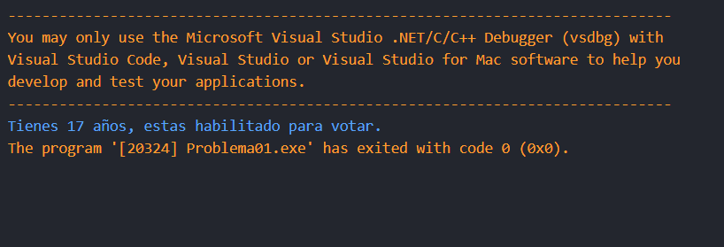
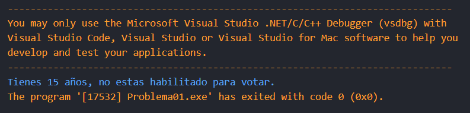

# Problema 01. Registro electoral

**Estructura elegida:** Estructura if-else 

**Justificación:** Al solo requerir una valiadión de edad, la estructura if-else o el operador ternario son efectivas aquí, yo escogí la estructura if-else solo por preferencia personal.

**Evidencias:**

