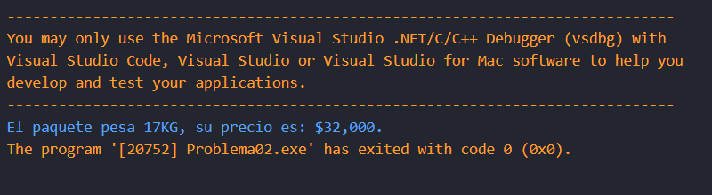
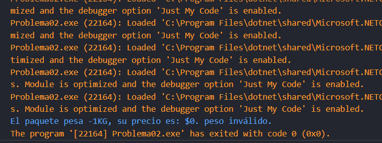

# Problema 2. Tarifa de envío por peso

**Estructura elegida:** Estructura if-else 

**Justificación:** Se requerían múltiples validaciones, por tanto, la estructura if-else fue la que utilicé para este punto. No se me ocurre otra estructura que pueda funcionar bien para este problema.

**Evidencias:**

