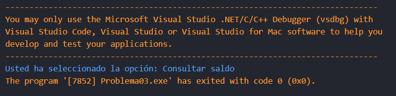
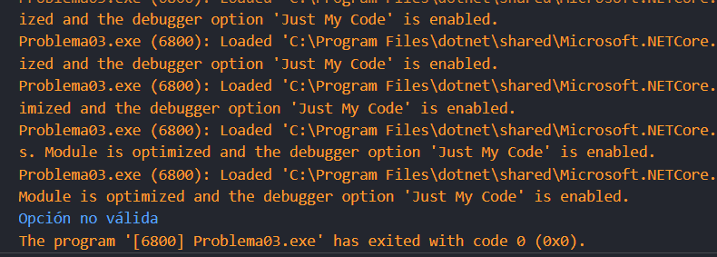

# Problema 3: Menú de cajero automático
**Estructura elegida:** Estructura switch expressions

**Justificación:** Al ser un menú, las estructuas switch son las que se deben usar, en este caso, se utilizó switch expressions para recortar código y porque no se necesitaba nada muy complejo.

**Evidencias:**

