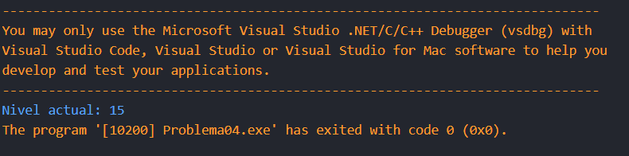
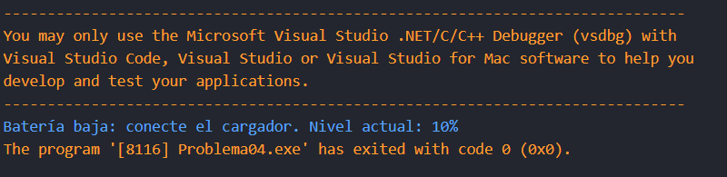

# Problema 4. Alerta de batería
**Estructura elegida:** Estructura operador ternario

**Justificación:** Si bien, al ser un "supervisor" de bateria, se podría usar una estructura if-else, debido a que la lógica no era muy compleja y para cortar lineas de código, decidí usar un operador ternario.

**Evidencias:**

