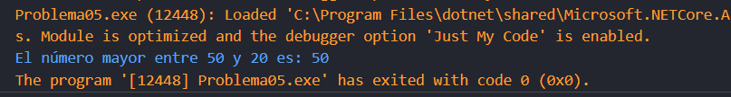
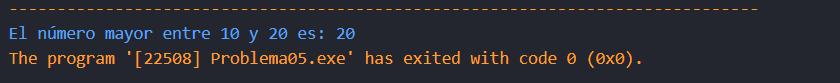

# Problema 5. El mayor de dos números
**Estructura elegida:** Estructura operador ternario

**Justificación:** Las instrucciones pedían que el número más grande se guardara en una variable usando una sola línea de asignación, identifiqué que eso solo se podría realizar mediante el operador ternario.

**Evidencias:**

