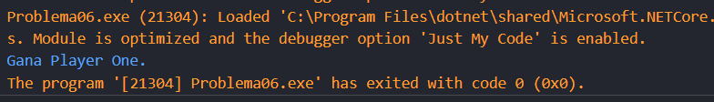
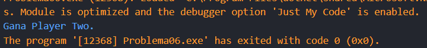

# Problema 6. Piedra, papel o tijera
**Estructura elegida:** Estructura switch expressions

**Justificación:** Se utilizó el switch expressions para definir las distintas opciones y jugadas posibles, no se necesitaba lógica compleja, por tanto, no era necesario usar el switch tradicional.

**Evidencias:**

