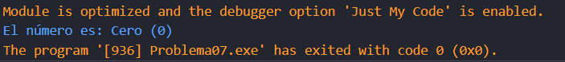
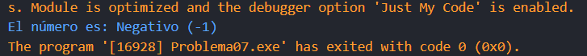
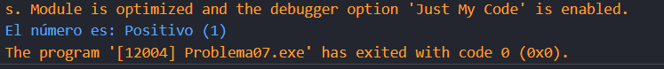

# Problema 7. Signo de un número
**Estructura elegida:** Estructura if-else

**Justificación:** El ejercicio tenía una serie de condiciones, por tanto, se usó la estructura if-else, también serviría la estructura de operador ternario, pero usé la if-else por preferencia personal.

**Evidencias:**

