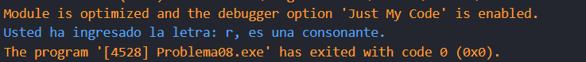
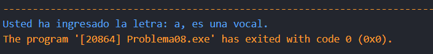
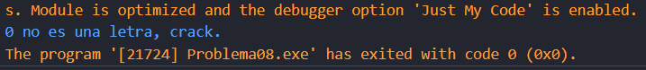

# Problema 8. Vocal o consonante
**Estructura elegida:** Estructura if-else

**Justificación:** Al carecer de conocimientos para resolver de otra manera, utilicé la estructura if-else para solventar lo que pedía el ejercicio, creo que el operador ternario también podría ser usado en este caso.

**Evidencias:**

