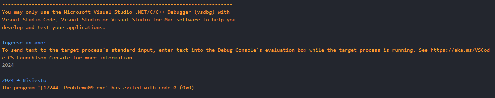
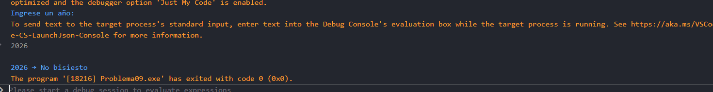

# Problema 9. Año bisiesto
**Estructura elegida:** Estructura if-else

**Justificación:** Escogí la estructura if-else porque es la más adecuada para realizar las validaciones necesarias para determinar si un año es bisiesto o no. además, considero que puede llegar a ser útil el operador ternario para simplificar algunas de las evaluaciones, pero en este caso, la claridad y la legibilidad del código son prioritarias, por lo que la estructura if-else es la elección más apropiada.

**Evidencias:**

