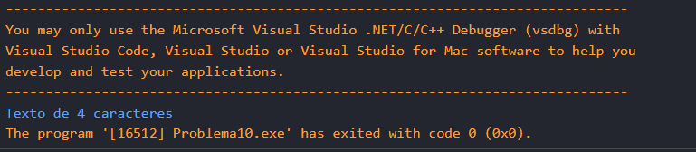
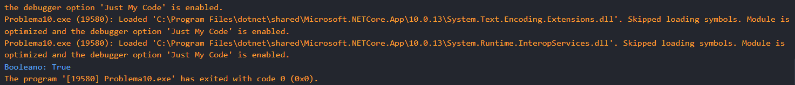

# Problema 10. Analizador de datos recibidos

**Estructura elegida:** Estructura switch

**Justificación:** al necesitar analizar los datos recibidos y realizar diferentes acciones según el tipo de dato, la estructura switch o switch expression son las más adecuadas para este caso.

**Evidencias:**

