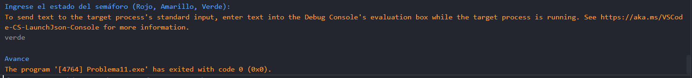

# Problema 11. Semáforo inteligente

**Estructura elegida:** Estructura switch

**Justificación:** Evalúa claramente los posibles estados del semáforo y asigna su respectiva instrucción. Considero que también se podría implementar switch expression o con if-else, pero la estructura switch tradicional es más clara y legible para este caso.

**Evidencias:**
