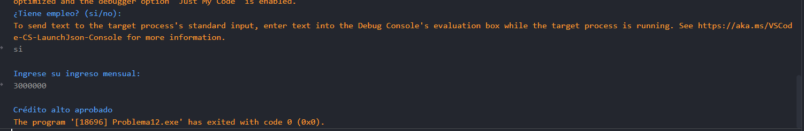

# Problema 12. Aprobación de crédito

**Estructura elegida:** Estructura if-else

**Justificación:** habia que verificar primero el requisito de empleo y, en caso afirmativo, evaluar los ingresos para definir el tipo de crédito. por lo tanto, la estructura if-else es la más adecuada para este problema. Además, la estructura if-else permite manejar de manera clara y concisa las diferentes condiciones y resultados posibles, lo que facilita la comprensión del código.

**Evidencias:**
