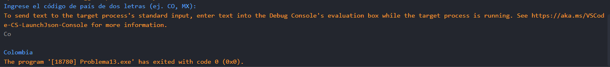

# Problema 13. Códigos de país

**Estructura elegida:** switch expressions

**Justificación:** Facilita la asignación directa de nombres de países según el código de letras ingresado, haciendo mas el código más corto y legible.

**Evidencias:**

mediante un toUpperCase() se asegura que el código ingresado sea siemore en mayúsculas, para que coincida con los casos del switch.

