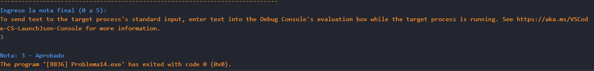

# Problema 14. Estado del aprendiz

**Estructura elegida:** Operador ternario

**Justificación:** Permite evaluar la nota y asignar el texto de estado de forma compacta en una sola línea, lo cual es más eficiente Y práctico.

**Evidencias:**
