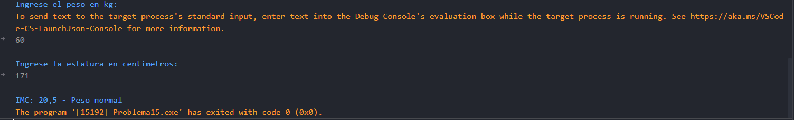

# Problema 15. Índice de masa corporal

**Estructura elegida:** Estructura if-else

**Justificación:** Permite clasificar el resultado del cálculo del IMC evaluando los rangos de manera ordenada. Sin embargo se podría haber utilizado una estructura switch-case para evitar múltiples condiciones, pero no es tan eficiente para este caso, ya que se requiere evaluar rangos de valores y no casos específicos.

**Evidencias:**

Tuve un inconveniente al momento de poner peso con decimales, ya que solo acepta correctamente los decimales y se separan por coma "," y no por punto ".", lo cual es un detalle importante a considerar al momento de ingresar los datos.
