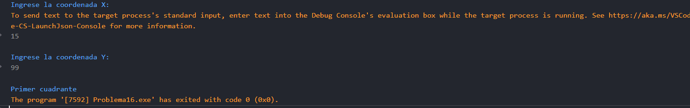

# Problema 16. Ubicación de un dron

**Estructura elegida:** Estructura if-else

**Justificación:** Evalúa en orden jerárquico si las coordenadas están en el origen, sobre un eje o en cuál cuadrante del plano cartesiano se ubican.

**Evidencias:**
