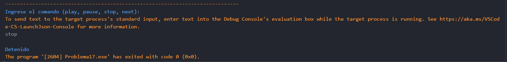

# Problema 17. Control de un reproductor

**Estructura elegida:** switch expression

**Justificación:** Permite asociar cada comando de texto con su mensaje de salida correspondiente, es mas consiso que el switch tradicional pero este tambien podria ser utilizado, según mi consideración.

**Evidencias:**
