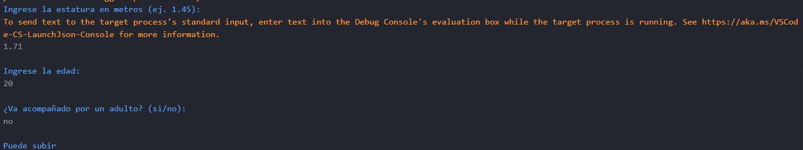

# Problema 18. Montaña rusa

**Estructura elegida:** Estructura if-else

**Justificación:** Agrupamos las condiciones complejas de estatura, edad y acompañante en una sola linea que evalúa todas las condiciones simultáneamente.

**Evidencias:**
