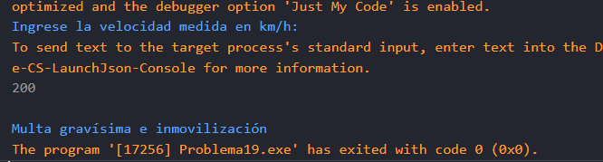

# Problema 19. Radar de velocidad

**Estructura elegida:** Estructura if-else

**Justificación:** Se validan en secuencia los rangos de velocidad para asignar la sanción correcta según las normas de tránsito.

**Evidencias:**

