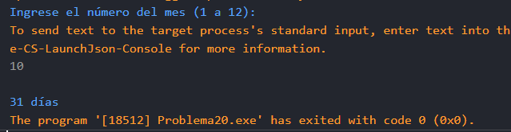

# Problema 20. Días de cada mes

**Estructura elegida:** switch expression

**Justificación:** Optimiza el código agrupando los meses que tienen igual número de días bajo un mismo resultado. Tambien se podria utilizar un switch, pero el switch expression es más conciso y legible para este caso.

**Evidencias:**

