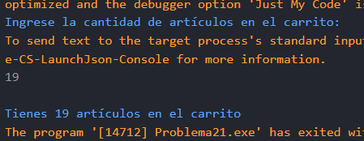
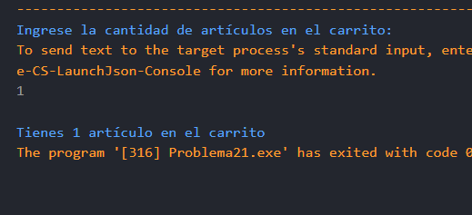

# Problema 21. Carrito de compras

**Estructura elegida:** Operador ternario

**Justificación:** Evalúa la cantidad para alternar entre singular y plural en una sola línea de asignación, lo que es más conciso y legible que utilizar una estructura if-else.

**Evidencias:**

