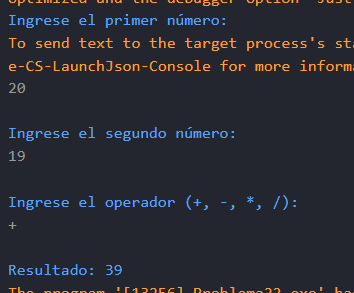

# Problema 22. Calculadora básica

**Estructura elegida:** switch expresion

**Justificación:** Facilita la evaluación de operadores aritméticos, es mas conciso y legible que utilizar una estructura switch tradicional.

**Evidencias:**

