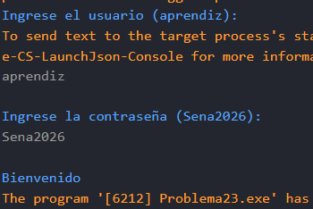

# Problema 23. Inicio de sesión

**Estructura elegida:** Estructura if-else

**Justificación:** Valida de forma secuencial la existencia del usuario y la veracidad de la contraseña por separado, lo cual permite un control detallado de cada condición. Considero que tambien se podia usar un operador ternario, pero la estructura if-else es mas clara y legible para este caso.

**Evidencias:**

