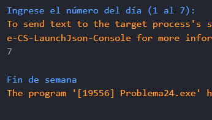

# Problema 24. ¿Día hábil?

**Estructura elegida:** switch expression

**Justificación:** Agrupa eficientemente los días de lunes a viernes como hábiles y el fin de semana por separado. Tambien se podria switch tradicional, pero la expresion es mas concisa y clara.

**Evidencias:**

