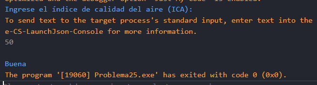

# Problema 25. Calidad del aire

**Estructura elegida:** Estructura if-else

**Justificación:** Evalúa secuencialmente los rangos del índice ICA para asignar su respectiva categoría. También se podría usar switch, pero la estructura if-else es más directa y clara para este caso.

**Evidencias:**

