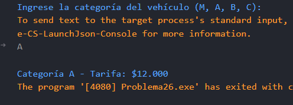

# Problema 26. Peaje

**Estructura elegida:** switch expression

**Justificación:** Asigna de manera limpia la tarifa vehicular y maneja los errores con excepciones. Además, permite una fácil expansión para agregar más tipos de vehículos en el futuro. Para este caso, tambien se podria usar switch tradicional, pero la switch expression es más concisa y legible.

**Evidencias:**

