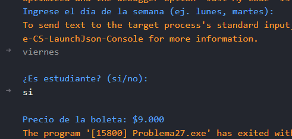

# Problema 27. Taquilla de cine

**Estructura elegida:** Estructura if-else

**Justificación:** Evalúa jerárquicamente las reglas del día y aplica el descuento según el estatus de estudiante. Considero que tambien podria ser usado switch, pero la estructura if-else me pareció mas apropiada para ese problema.

**Evidencias:**

