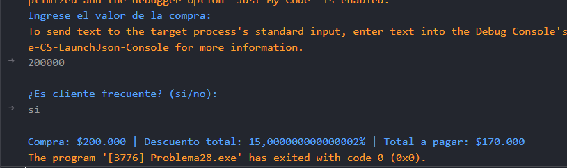

# Problema 28. Descuento por compra

**Estructura elegida:** Estructura if-else if-else

**Justificación:** Permite calcular el descuento por rangos de valor e incorporar el porcentaje adicional para clientes frecuentes. Sin embargo, se podría utilizar una estructura switch-case para manejar los rangos de descuento, pero la estructura if-else me pareció más comoda para trabajar con estas condiciones.

**Evidencias:**
Tuve problemas con el tema de los descuentos, si se aplican, pero no comprendo por qué se muestra ese número que, al menos a mí parecer, es muy grande.

