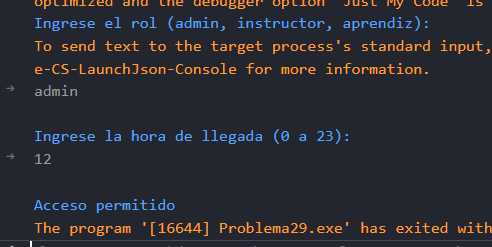

# Problema 29. Control de acceso a la sede

**Estructura elegida:** Estructura if-else

**Justificación:** Verifica las condiciones horarias y de rol institucional para autorizar el paso por el torniquete. AL ser condciones algo complejas, se optó por la estructura if-else para evaluar cada caso de manera clara y ordenada, en vez del operador ternario u otras estructuras.

**Evidencias:**

