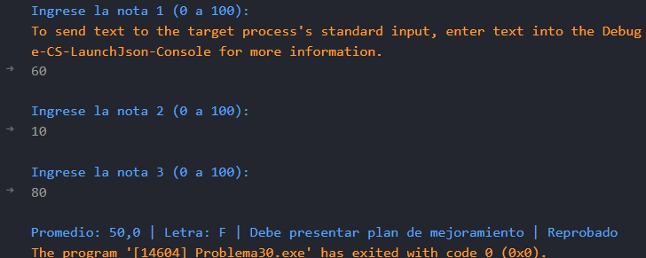

# Problema 30. Boletín de calificaciones

**Estructura elegida:** Switch expression

**Justificación:** Si bien facilita el cálculo del promedio, la asignación cualitativa y la validación de menciones de honor de forma estructurada y concisa, considero que podría ser mejor utilizar un switch tradicional para manejar los casos de manera más explícita y clara, especialmente si se requiere realizar acciones adicionales para cada caso.

**Evidencias:**

